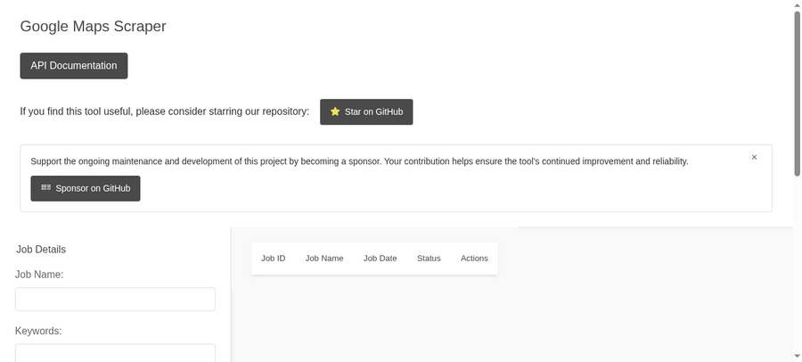

<!--
N.B.: This README was automatically generated by https://github.com/YunoHost/apps/blob/master/readme_template.md
via apps-tools script
-->

<h1>
  
  Google Maps Scraper for YunoHost
</h1>

*[Lire ce readme en français.](./README_fr.md)*

> *This package allows you to install [Google Maps Scraper](https://github.com/gosom/google-maps-scraper) quickly and simply on a YunoHost server.*
> *If you don't have YunoHost, please consult [the guide](https://yunohost.org/#/install) to learn how to install it.*

## Overview

Scrape Google Maps business listings with a web UI and REST API.

**Shipped version:** 1.18.1

## Disclaimer

Automated scraping of Google Maps may violate Google's Terms of Service. Use responsibly, at modest volume, and at your own risk.

## Documentation and resources

- Official app website: https://github.com/gosom/google-maps-scraper
- Upstream repository: https://github.com/gosom/google-maps-scraper
- YunoHost community forums: https://forum.yunohost.org

## Limitations

The web UI and API hardcode absolute URLs, so this app must be installed at the root of its domain (path `/`). Scraping requires the bundled headless Chromium (a few hundred MB, installed automatically).

## Config panel

This package does not ship a config panel: scraping options are set per job in the web UI/API, and the upstream binary takes no server-side config file.

## Screenshots

## Developer info

### How to edit and test this package

Please read [the YunoHost doc on packaging](https://doc.yunohost.org/en/dev/packaging/), and in particular these docs about [app packaging](https://doc.yunohost.org/en/dev/packaging/apps).

You are advised to clone the repo and install the app with `yunohost app install https://github.com/quartztester/google-maps-scraper_ynh`.

### How to submit a PR

When submitting a pull request, please make sure that your branch is up to date with the main branch and that you tested the install/upgrade cycle.

#### Notable software components this app uses:

* [Go](https://endoflife.date/go): programming language the binary is built with

#### Best Practices

Please read [the guidelines](https://doc.yunohost.org/en/dev/packaging/best_practices) before contributing.
