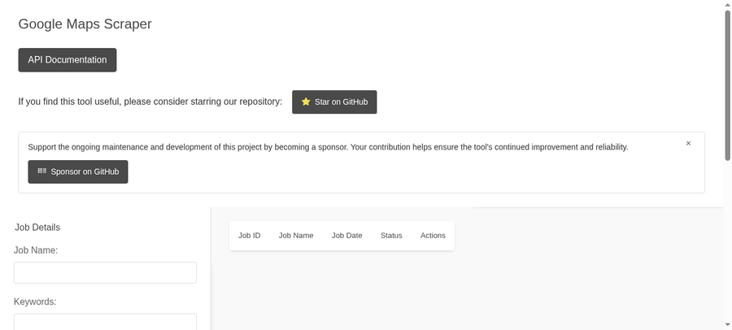

<!--
N.B.: This README was automatically generated by <https://github.com/YunoHost/apps_tools/blob/main/readme_generator>
It shall NOT be edited by hand.
-->

<h1>
  
  Google Maps Scraper, packaged for YunoHost
</h1>

Scrape Google Maps business listings with a web UI and REST API

[](https://github.com/gosom/google-maps-scraper)
[?style=for-the-badge)](https://ci-apps.yunohost.org/ci/apps/gmaps/)

<div align="center">
<a href="https://apps.yunohost.org/app/gmaps"></a>
<a href="https://github.com/quartztester/google-maps-scraper_ynh/issues"></a>
</div>

## Screenshots



## 📦 Developer info

[](https://apps.yunohost.org/ci/apps/gmaps/)

🛠️ Upstream Google Maps Scraper repository: <https://github.com/gosom/google-maps-scraper>

Pull requests are welcome and should target the [`main` branch](https://github.com/quartztester/google-maps-scraper_ynh/tree/main).

The `main` branch can be tested using:
```
# fresh install:
sudo yunohost app install https://github.com/quartztester/google-maps-scraper_ynh/tree/main

# upgrade an existing install:
sudo yunohost app upgrade gmaps -u https://github.com/quartztester/google-maps-scraper_ynh/tree/main
```

### 📚 App packaging documentation

Please see <https://doc.yunohost.org/packaging_apps> for more information.
