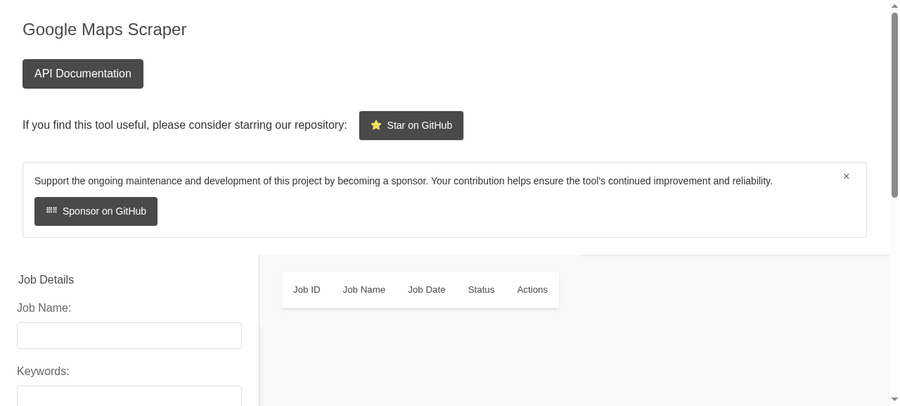

<!--
N.B. : Ce README a ete automatiquement genere par <https://github.com/YunoHost/apps_tools/blob/main/readme_generator>
Il ne doit PAS etre edite a la main.
-->

<h1>
  
  Google Maps Scraper, empaquete pour YunoHost
</h1>

Extracteur de fiches Google Maps avec interface web et API REST

[](https://github.com/gosom/google-maps-scraper)
[?style=for-the-badge)](https://ci-apps.yunohost.org/ci/apps/gmaps/)

<div align="center">
<a href="https://apps.yunohost.org/app/gmaps"></a>
<a href="https://github.com/quartztester/google-maps-scraper_ynh/issues"></a>
</div>

## Captures d'ecran



## 📦 Informations developpeur

[](https://apps.yunohost.org/ci/apps/gmaps/)

🛠️ Depot amont de Google Maps Scraper : <https://github.com/gosom/google-maps-scraper>

Les pull requests sont les bienvenues et doivent cibler la branche [`main`](https://github.com/quartztester/google-maps-scraper_ynh/tree/main).

La branche `main` peut etre testee avec :
```
# installation fraiche :
sudo yunohost app install https://github.com/quartztester/google-maps-scraper_ynh/tree/main

# mise a jour d'une installation existante :
sudo yunohost app upgrade gmaps -u https://github.com/quartztester/google-maps-scraper_ynh/tree/main
```

### 📚 Documentation d'empaquetage d'app

Veuillez consulter <https://doc.yunohost.org/packaging_apps> pour plus d'informations.
